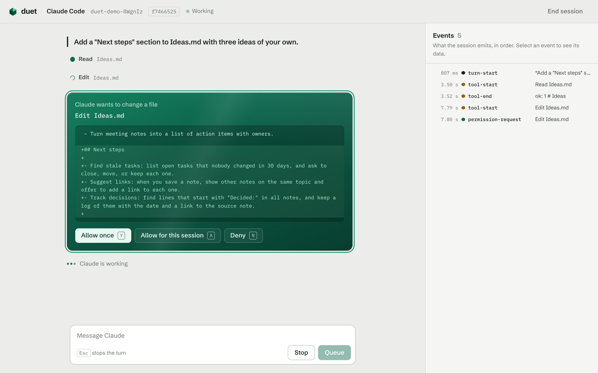

# duet-demo

A browser app that runs a live Claude Code or Codex session. It is a small example of an app built on [obsidian-duet](https://github.com/nathanaday/obsidian-duet), the TypeScript library behind the Duet plugin for Obsidian.



## About

Claude Code and Codex are strong agents, but each speaks its own protocol, and each puts its approvals in its own terminal. The obsidian-duet library gives an app one interface for both: start a session, send messages, stream the reply and the tool calls, answer approval requests, stop a turn, and resume an earlier session.

This demo shows that interface in a browser. The conversation pane shows what a user sees. The event pane lists every event that the library emits, in order, so you can use it as a reference when you build your own interface.

## Quickstart

### Prerequisites

- Node.js 22 or later.
- Claude Code (`claude`) or the Codex CLI (`codex`), installed and logged in. The demo uses your own installation and login.

### Start

```sh
git clone https://github.com/nathanaday/duet-demo.git
cd duet-demo
npm install
npm run dev
```

Open http://localhost:5199. `npm install` also builds the library from its repository.

## Usage

1. Choose an agent: Claude Code or Codex.
2. Choose a folder for the agent to work in. Leave it empty to give the session a fresh copy of a small sample vault in a temporary folder, so your own files stay as they are.
3. Choose when the agent asks before it acts, then select **Start session**.

In the session:

- **Send** a message. A message that you send while the agent works waits for the current turn.
- **Approve** a file change or a command when the agent asks: press `Y` to allow it once, `A` to allow it for the session, or `N` to deny it.
- **Stop** a turn with the stop button or Escape.
- **Inspect** each event in the event pane. Select an event to see its data.
- **Continue** an earlier session: on the start page, select **Continue an earlier session** and paste its id.

A folder that you choose is not a copy. The agent can change its files when you allow it.

## How it works

`server/api.ts` is a Vite plugin that hosts the sessions inside the Vite dev server, so one command starts everything. It uses the library's `createSession` for both agents. The browser receives events over Server-Sent Events and sends messages, approvals and interrupts as POST requests. The server keeps each session's event log and replays it when the browser reconnects.

The library's design notes are in the [obsidian-duet repository](https://github.com/nathanaday/obsidian-duet/blob/main/docs/design.md).

## License

[MIT](LICENSE)
